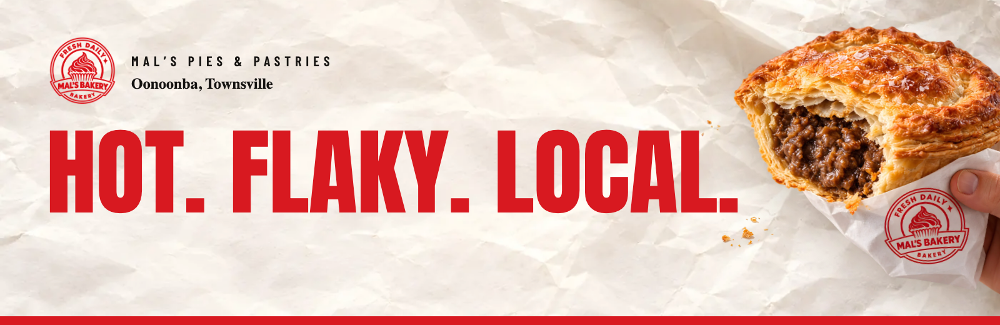
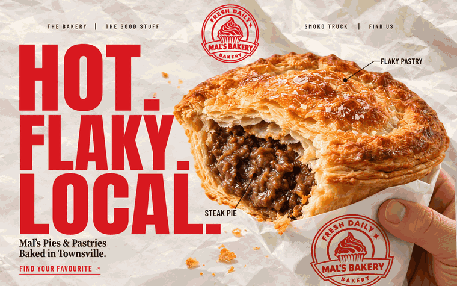
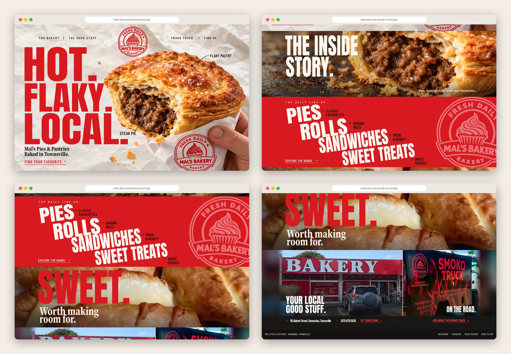
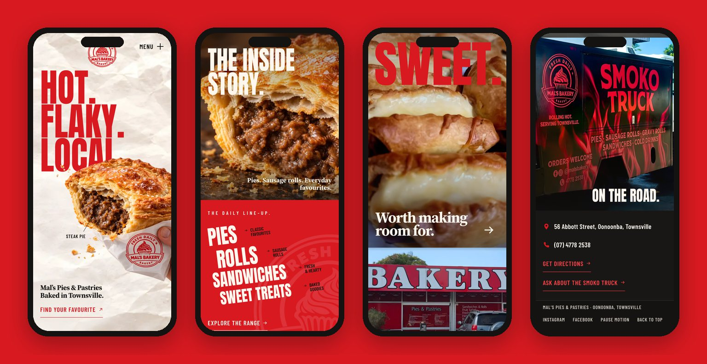
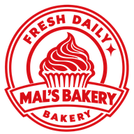

<div align="center">



<h3>A one-page website for a Townsville bakery, rebuilt from the approved "First Bite" board, with a pinned hero that dives into the pie.</h3>

<p>
  <a href="https://mals-pies-oonoonba.vercel.app"><strong>🌐 Live site</strong></a>
  &nbsp;·&nbsp;
  <a href="#hero-animation"><strong>🎬 How the hero works</strong></a>
  &nbsp;·&nbsp;
  <a href="#getting-started"><strong>🛠️ Run it locally</strong></a>
</p>

<p>
  <a href="https://mals-pies-oonoonba.vercel.app"></a>
  
  
  
  
</p>

</div>

<br />

## 🚀 Overview

**Mal's Pies & Pastries** bakes pies, sausage rolls, sandwiches and sweet treats on Abbott Street in Oonoonba, Townsville, and takes them on the road in the black and red Smoko Truck. The site follows the visual direction the client picked, Model 2 **"The First Bite"**: a pie held in one hand on baking paper, **HOT. FLAKY. LOCAL.** in big red letters, then the inside of the pie, the red daily line-up, the sweets and the real shopfront next to the real truck.

The desktop page is the approved board itself, measured and rebuilt in HTML, and every scene has its own scroll animation.

- **Board-exact desktop**: plates registered on the approved board, every line of type fitted to the board's ink boxes
- **One narrative thread**: the camera pushes into the pie and opens the next scene from the filling; the Mal's seal returns in the red line-up, spinning in like a stamp
- **Built for every visitor**: compact phone layout, static page with reduced motion, Save-Data or **Pause motion**, full keyboard support, nothing hidden without JavaScript
- **Light**: 1.45 MB for the whole page on desktop, about 1.07 MB on a phone's first load, 3.7 KB of gzipped JavaScript and no runtime dependency

<br />

<a name="hero-animation"></a>

## 🎬 The hero animation

<div align="center">
  <a href="https://mals-pies-oonoonba.vercel.app"></a>
  <sub>Scroll-scrubbed on the live site · captured at 1440 × 900</sub>
</div>

<br />

On load, a 1.8 s opening runs the kit's motion script: the pastry macro pulls back and wipes away, the pie arrives with a 2° turn and the three words rise one after another. Then the hero stays pinned for 1.2 screen heights:

| Scroll  | What happens                                                                                       |
| :------ | :------------------------------------------------------------------------------------------------- |
| 0–25%   | The camera pushes into the pie (up to 1.23×, −1.4°); callouts and copy fade                         |
| 10–55%  | **HOT. FLAKY. LOCAL.** lifts away line by line                                                       |
| 26–70%  | A circular window opens from the filling onto the macro of **The Inside Story**, which settles from 1.24× |
| 58–98%  | **THE INSIDE / STORY.** rise out of their masks; the caption slides in                               |
| 100%    | The real scene 2 sits in exactly the same slot and takes over; the page scrolls on                  |

**Under the hood**

- 📐 **Measured, not guessed.** The approved board (891 × 1765 px) was split into scenes, the campaign plates were placed on it with SIFT feature matching, and the type was fitted line by line: a Playwright script measures Anton, Barlow Condensed and Source Serif 4 in Chromium and generates `board-type.css` (size, horizontal scale or tracking for 35 text items).
- 🖥️ **Two densities.** The hero uses its own unit so it always fills one screen; the scenes below keep the density of a 1024 px board, centred, with photos and colour bleeding to the edges. The pie and its callouts are anchored to the right edge of the screen, so the hand is never cut on wide monitors.
- 🔁 **Dock and swap.** The iris runs on a decorative copy of scene 2 docked inside the pinned stage; the real section rises hidden into the same slot and takes over once it is there. Measured at the swap: 0.8 / 255 mean pixel difference.
- 🥐 **Details lifted from the board.** The pastry crumbs on the paper exist only in the approved board, so they were extracted from it (colour mask minus the registered pie) into their own layer.
- 🐢 **Graceful by default.** Reduced motion, Save-Data, `?static` or **Pause motion** give a normal static page: no pinned runway, every scene visible.

<br />

## 🖥️ Sections

<div align="center">
  
</div>

<br />

| #   | Section                                  | Anchor            | Motion                                                                                   |
| :-- | :--------------------------------------- | :---------------- | :--------------------------------------------------------------------------------------- |
| 01  | **HOT. FLAKY. LOCAL.**                   | `#start`          | Opening sequence, pinned camera push, mouse parallax on desktop                           |
| 02  | **THE INSIDE STORY.**                    | `#the-good-stuff` | Opens from the pie's filling, macro settles, title lines rise from masks                  |
| 03  | **THE DAILY LINE-UP.**                   | `#the-range`      | Words slide out along their own diagonal, notes follow, the seal spins in and keeps drifting |
| 04  | **SWEET.** Worth making room for.        | `#sweet-treats`   | Photo opens from a band, letters stamp down one by one, serif lines rise                  |
| 05  | **YOUR LOCAL GOOD STUFF. / ON THE ROAD.** | `#find-us`        | Shopfront wipes in from the left, the truck drives in from the right, contact bar staggers |

Each category in the line-up (and **Explore the range**, and the arrow under **SWEET.**) opens a native dialog with tabs for pies, rolls, sandwiches and sweet treats. **Ask about the Smoko Truck** opens its own dialog; both end in a call to the bakery.

<br />

## 📱 Mobile first, motion optional

<div align="center">
  
</div>

<br />

- The headline sits above and partly behind the pie; on scroll the camera tilts down so the crust stays in view while scene 2 opens below
- The line-up keeps its diagonal; shopfront and truck stack, with the contact details as a list
- Every touch target is at least 44 px; no horizontal scroll at 360, 390 or 768 px
- Nothing depends on hover

<br />

## ✨ Highlights

- **🎞️ Scroll storytelling without a library**: one `requestAnimationFrame` render per scroll event, transforms and clip-paths only, every value derived from the scroll position (scrubs both ways, 60 fps measured)
- **🪟 Native dialogs**: `<dialog>` with tabs (arrow keys, Home, End), Escape and backdrop to close, focus back on the control that opened it
- **📞 Honest contact**: phone, directions, Instagram and Facebook are real links; no fake order flow or "message sent" screen
- **🧾 Content in the HTML**: menu panels and contact details are rendered at build time from one data file, so the page works without JavaScript
- **🖼️ Image pipeline**: viewer interface removed from the two supplied captures (only that), Real-ESRGAN upscales, WebP in three widths each
- **🧪 Browser QA**: `npm run qa` (68 checks: density, overflow, hand-off, dialogs by pointer and keyboard, links, copy hygiene, reduced motion, no-JS, frame cadence) and `npm run compare` against the board

<br />

## 💻 Tech stack

| <br />Vite 6 | <br />JavaScript | <br />HTML5 | <br />CSS3 | <br />Python | <br />Playwright | <br />Vercel |
| :---: | :---: | :---: | :---: | :---: | :---: | :---: |

### Why this stack?

- **Vite + plain JavaScript**: a one-page site for a local bakery needs static HTML and two small modules (motion, dialogs), not a framework runtime
- **Hand-written scroll engine**: five scenes, a pinned hero and a dock-and-swap hand-off fit in 10 KB of minified JavaScript with no dependency
- **Python (OpenCV, Pillow, Real-ESRGAN)** for the board measurements, plate registration and image preparation; the scripts stay in the repo
- **Playwright** for fitting type in a real browser and for QA
- **Vercel**: every push to `main` deploys automatically

<br />

## 🎨 Design system

| Token        | Value                                                                        | Use                                         |
| :----------- | :--------------------------------------------------------------------------- | :------------------------------------------ |
| Red          |  | Headline, the line-up scene, links on paper |
| Ink          |  | Labels, callouts, footer                    |
| Cream        |  | Type on photos and on red, dialogs          |
| Paper        |  | Hero ground under the photographed paper    |
| Contact bar  |  | Address, phone and links under the photos   |
| Red on dark  |  | Links on the dark bar (contrast)            |

- **Type**: Anton for display, Barlow Condensed SemiBold for labels, Source Serif 4 Bold for the short serif lines; all self-hosted WOFF2 subsets (OFL)
- **Grid**: the approved board, 891 board px wide, drawn at `min(100cqw, 1600px, 166svh) / 1024` per board px
- **Scenes**: the hero fills one screen; the four scenes below take 0.35 to 0.56 of a screen each (measured at 1024 to 1920 px)
- **Motion**: scroll-scrubbed, ease-out cubic, transforms and clip-paths only; dialogs open in 380 ms

<br />

<a name="getting-started"></a>

## 🛠️ Getting started

```bash
# Clone the repository
git clone https://github.com/Jeanfr1/Mals-Pies-website.git
cd Mals-Pies-website

# Install dependencies (Node 20.10+)
npm install

# Start the dev server  →  http://localhost:4396
npm run dev

# Production build  →  dist/
npm run build

# Preview the production build  →  http://localhost:4397
npm run preview

# Browser QA and the side-by-side with the approved board (needs the preview running)
npm run qa
npm run compare

# Rebuild the web images (Python 3 with Pillow, OpenCV, torch + spandrel;
# Real-ESRGAN x4plus weights in ~/.cache/realesrgan)
python3 scripts/clean-captures.py
python3 scripts/upscale.py <in.png> scripts/out/up/<name>.png   # per image
npm run images
```

<br />

## 📁 Project structure

```
Mals-Pies-website/
├── index.html                 # The five scenes, the docked copy of scene 2, dialogs, footer
├── src/
│   ├── main.js                # Entry: styles, dialogs, motion
│   ├── data/menu.js           # Menu panels and contact details (rendered into the HTML at build)
│   ├── js/
│   │   ├── motion.js          # Opening, pinned hero, dock and swap, per-scene scroll motion, pause
│   │   └── dialogs.js         # Range and Smoko Truck dialogs, tabs, focus return
│   ├── styles/
│   │   ├── base.css           # Tokens, fonts, footer, dialogs
│   │   ├── board.css          # Desktop: the approved board in board px
│   │   ├── board-type.css     # Generated by scripts/fit-type.mjs
│   │   ├── compact.css        # Phones, tablets in portrait
│   │   └── motion.css         # Motion states and the opening keyframes
│   └── assets/                # WebP images (generated) and WOFF2 fonts with their licences
├── public/                    # Favicon, Open Graph image, robots.txt
├── scripts/                   # register-board, measure-type, fit-type, clean-captures, upscale,
│                              # prepare-images, extract-crumbs, qa, board-compare, README captures
├── references/ roteiros/ docs/ brand/ images/ animation/ site/   # The design kit, kept as delivered
└── LEIA-ME-KIT.md             # The kit's own README (Portuguese)
```

The kit folders stay in the repository as the source of truth and are left out of the deploy (`.vercelignore`).

<br />

## 🚀 Deployment

Hosted on **Vercel** and connected to this repository: every push to `main` ships to production.

**Live site:** [mals-pies-oonoonba.vercel.app](https://mals-pies-oonoonba.vercel.app)

| Setting          | Value           |
| :--------------- | :-------------- |
| Framework        | Vite            |
| Build command    | `npm run build` |
| Output directory | `dist`          |

The site answers with `noindex` (meta tag, `X-Robots-Tag` header and `robots.txt`) until its domain is confirmed.

<br />

## 📌 Content checklist

Items waiting on the client. Each one is marked `TODO(mals)` in the code.

- [ ] Domain, then `canonical` and `og:url`, and drop `noindex` (`index.html`, `vercel.json`, `public/robots.txt`)
- [ ] The bakery's own Google Maps place link (the links search the name and address for now)
- [ ] Confirm the menu list, transcribed from the bakery's window board; no prices or opening hours are published
- [ ] Confirm that the **SWEET.** photo shows a sweet custard bake (parts of the filling read as savoury); the caramel tarts photo is the fallback
- [ ] Permission for the shopfront photo (a visitor's review photo) and the Smoko Truck photo (social media), or clean originals from the owner

Choices made where the kit contradicted itself:

- The board reads **GOOD STOFF.**; the site says **GOOD STUFF.**, as in the kit's copy file
- Award and ranking claims seen on social media are not on the page until confirmed
- The kit's *Replay intro* and *Take a closer look* controls are not on the approved board, so they were left out; **Pause motion** lives in the footer

<br />

## 🙏 Acknowledgments

- **Mal's Pies & Pastries** for the brief, the photos and the approved visual direction
- **[Anton](https://fonts.google.com/specimen/Anton)** by Vernon Adams, **[Barlow Condensed](https://fonts.google.com/specimen/Barlow+Condensed)** by Jeremy Tribby and **[Source Serif 4](https://fonts.google.com/specimen/Source+Serif+4)** by Frank Grießhammer for Adobe (OFL)
- **[Real-ESRGAN](https://github.com/xinntao/Real-ESRGAN)** by Xintao Wang et al. for the upscales
- **[Vite](https://vite.dev)**, **[Playwright](https://playwright.dev)** and **[Vercel](https://vercel.com)**

<br />

---

<div align="center">
  
  <p><strong>Hot. Flaky. Local.</strong></p>
  <p>Built with ❤️ by <a href="https://github.com/Jeanfr1">Jean</a> for Mal's Pies &amp; Pastries</p>
  <sub>© 2026 Mal's Pies &amp; Pastries. All rights reserved.</sub>
</div>
